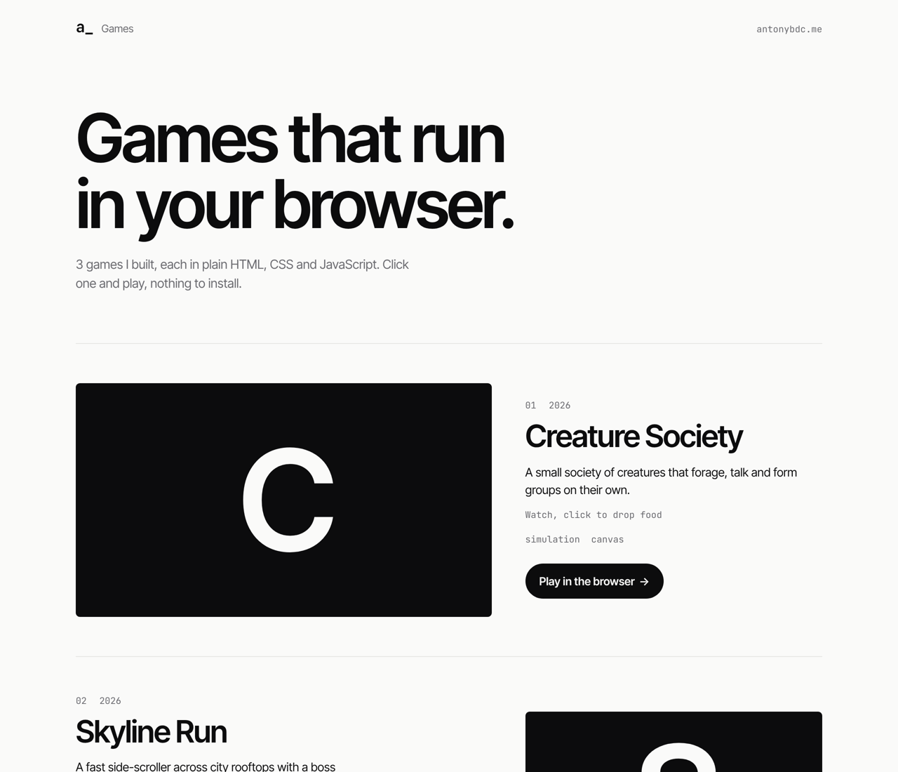
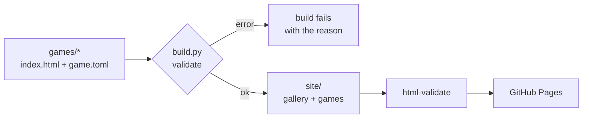

# games-showcase

My browser games in one place, playable without installing anything.
Every push checks each game, builds a gallery and publishes it to GitHub Pages.





## Add a game

```
games/my-game/
  index.html   # the game
  game.toml    # title, description, year, tags, controls
  cover.png    # optional, 16:9
```

Push to `main`. The workflow runs the tests, validates every game, checks the gallery HTML
and deploys. Pull requests run the same checks without deploying, so a broken game never goes live.

## What the build checks

- every folder has `index.html` and a valid `game.toml` with title, description and year
- folder names are URL-safe
- each game stays under a 25 MB budget (Pages is not a CDN)
- all problems are listed at once, not one per run

Locally: `make test`, `make serve` → http://localhost:8000

## Design decisions

- **Static, no framework.** The games are plain HTML files; the gallery is generated by one Python script without dependencies, so it builds in a second and will still build in five years.
- **Fail before publishing.** Validation runs in the same job as the build; deploy only happens on `main` after everything passed.
- **Self-hosted fonts** (Inter Tight, JetBrains Mono, OFL), no third-party requests, light and dark mode.
